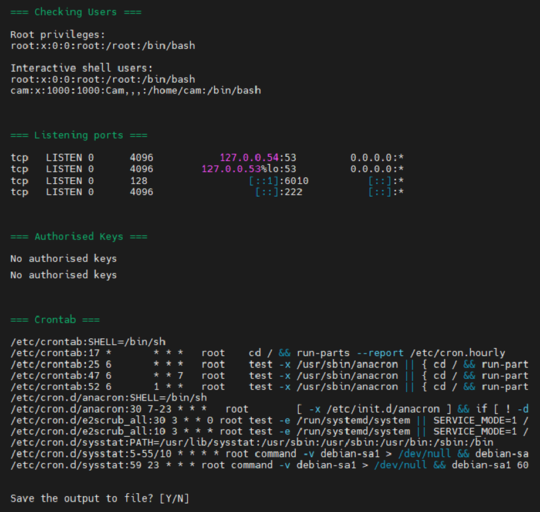

# Who Goes There?

A minimal bash script for quick Linux system auditing and user discovery. 

I find this useful for quick basic routine checks when working across multiple servers, or alongside security projects.


- Displays current time configurations and the active user context.
- Lists accounts with root privileges (UID 0) and users with interactive shells.
- Extracts currently listening TCP/UDP ports and active processes.
- Checks for the presence of authorized SSH keys under `/root` and the current user's home directory.
- Extracts un-commented, active tasks from system crontabs.
- Prompts option to save the output to a .txt.



## Usage

```bash
sudo ./whogoesthere.sh
```
*Note: Running with sudo is recommended to ensure complete output (i.e. listening ports and root SSH key checks).*
